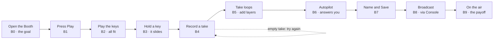

# Tutorial design: the Psycho-Acoustic Grid and the Booth

Nov 13, 2026. **Built** in `js/musictut.js` (see Status at the end). Copied from the doc https://claude.ai/artifact/CX38MedPwfWXwLcgs2eb3N (the doc is the editable version). Built on the tutorial research report "Teach the colony at the moment of need".

## Summary

The tutorial teaches the music system inside the real Acoustic Panel, at the moment each part first matters, and drives the player to one success: **a loop they played, kept on the shelf and broadcast to their own city**. Everything before that is a step toward it; everything after is a one-time tip.

- **Two short tracks plus tips.** Track 1 (the Grid and the Console) is 6 notes. Track 2 (the Booth) is 10 notes and ends with the player's loop playing over the city. Advanced features (songs, Rewire, Transform, Stasis on loops) get one-line tips the first time they're touched.
- **Fired by state, finished by doing.** Each note appears when its moment comes and counts as learned when the player does the thing, even outside the tutorial. Nothing blocks the controls, stops the music or moves the view on its own.
- **Plain words under city names.** Every note gives the diegetic name with its plain meaning ("Smog, how bright or muffled the sound is"), plus an optional **Why?** that explains the music behind it.
- **No failure to design, so one designed surprise instead.** Magic keys can't play a wrong note, so the Booth is already a safe sandbox. The memorable moment is holding a key across a chord change and hearing the note slide to fit. The only real failure, an empty take, gets a clear one-line fix.
- **Measured from the first build.** Time from first Booth open to first broadcast loop is the number that matters, checked with small think-aloud playtests.

All of this rests on the tutorial research report; where it's inference for this system, the text says so.

## What the player has to learn

The system has three layers, and most players only ever need the first. The tutorial should treat the Console as optional depth and the Booth as the real hands-on loop.

| Part | What it is | Where players will get stuck (from the code) |
| --- | --- | --- |
| The Grid and the corner player | The megastructure that makes the city's music live; music plays only while it stands. The player shows the program, chord and a live trace. | Nothing says the music is generated and never repeats, which is the whole point. The Acoustic Panel opens by a button or a double-click on the building, which few will guess. |
| The Console | About 10 knobs with city names (Clock rate, Smog, Resonance, Output, Hum, Hold, Density, Static, Rate, Depth), programs, Auto-governor, Stasis, Drift, the carrier pattern list, pings and Transform. Each group has a live shape. | The names hide the meaning, and several hover texts are flavor only (Clock rate's says "the metabolic pacing of the sector's population", never "tempo"). The Auto-governor drifts the knobs on its own, which will look like the panel ignoring the player. |
| The Booth | Pick chords and a voice, play 12 magic keys over a 4 or 8 bar loop, record takes as layers, let the autopilot answer, save to the Loop shelf. | Opening it pauses the city and the broadcast steps aside, so the city goes quiet with no explanation. Record waits for the next bar (or a count-in), which can feel unresponsive. The way back to the city, picking a shelf loop in the Console's carrier pattern list under "Booth shelf", is two screens away and easy to miss. |
| Song features | Load a song from the player's computer; the Booth finds its key, tempo, chords and a section, and builds a pattern, a sampler and chops. Rewire, Activity, Stasis on loops, Transform pings. | Powerful but deep. These are for players who already finished the core loop, so they get tips on first use, not tutorial steps. |

## Principles from the research, applied here

Each design choice below traces to a finding in the report. The report's own caveat holds: no study tested tutorials in a music tool inside a city builder, so the right column is inference to be checked in playtests.

| Finding (strength) | What it means for the Grid and the Booth |
| --- | --- |
| Teaching at the moment of need beat an up-front manual by 40% in the complex game (controlled, Andersen 2012) | No music lesson at game start. The Grid notes fire when the Grid first broadcasts; the Booth notes fire on the first Booth open. |
| Blocking or forced steps added nothing (controlled) | No locked buttons, no forced order. Every control works the whole time, and a note simply waits. |
| A help button alone was used by 31% (controlled) | The hover texts and long-press plates stay, but they support the notes; they can't replace them. |
| One strong channel beats a buffet of help types (controlled, Kao 2020) | One channel: the operator note the city tutorial already uses. No video, no separate manual. |
| Spatial cues next to the target beat side text, in complex tasks (controlled, Kao 2021; Mayer spatial contiguity) | Each note sits beside the control it names, inside the panel, not in a corner. |
| Players fail at noticing more than at doing (practitioner, Liu 2023) | A slow outline pulse on the one target control, plus an arrow from the note. Not color alone. |
| Guided discovery beats both lectures and "figure it out" (meta-analysis, d = 0.50) | The Booth is a sandbox with a few scaffolds: the notes point the way, the player makes the music. |
| Guidance helps novices and hurts experts (expertise reversal, d = 0.51 / -0.43) | A first-open choice changes wording and pace, never coverage: "New to making music" and "I play an instrument" see the same steps. |
| Failure then explanation builds understanding, if the failure is designed and cheap (meta-analysis, g = 0.36) | Magic keys remove wrong notes, so the designed moment is a surprise rather than a failure: hold a key across a chord change and hear it slide. The Why? explains it right then. |
| Tutorials fail when they teach the interface instead of the core loop (Factorio) | The Booth track ends with the player's own loop broadcast to the city, not with a tour of every button. |
| Steps without the goal confuse (Surviving Mars) | The first Booth note states the goal: make a loop and play it to your city. |
| Front-loaded text drives players away (CK3, 67 boxes) | 6 Console notes, 10 Booth notes, each at most two short sentences. The other 30 or so controls are left to hover texts and first-use tips. |
| Schematic pictures teach better than realistic ones (meta-analysis, d = 0.45 vs 0.01); PhET's coordinated representations | The Console's shapes already move with the knobs. The first Console note teaches "turn a knob, watch its shape, hear the change", one action in three views. |
| Practice without failure, replayable instructions, no context change the player didn't start (accessibility guidelines, XAG 114) | Every note can be skipped and replayed from Settings. A note never switches tabs or scrolls the panel; a Show me button does it only when pressed. |

## Track 1: the Grid arrives, and the Console

Six notes. The first two fire in the city when the Grid starts broadcasting for the first time; the other four fire the first time the Acoustic Panel opens on the Console. The goal is three ideas: the music is made live, the knobs reshape it, and nothing you do is permanent.

| # | Fires when | The note says (desktop wording; touch in brackets) | Done when | Why? (optional, on press) |
| --- | --- | --- | --- | --- |
| G1 | The Grid finishes arriving and its broadcast starts, first time | The Psycho-Acoustic Grid is now broadcasting. It makes the city's music live, so it never plays the same thing twice. | 8 seconds pass, or the player clicks the corner player | The music is built from rules while you listen: chords, melodies and textures are chosen as it plays, not loaded from a recording. |
| G2 | Right after G1 | Click Acoustic panel, or double-click the Grid building, to shape the music. [Tap the music pill, then Acoustic panel.] | The panel opens. If it doesn't within 20 seconds, the note fades and the track waits for the first open. | |
| C1 | The panel opens on the Console, first time | Each shape is a picture of one part of the music. Drag any knob up or down and watch its shape change as the sound does. | Any knob moves | The shapes are drawn from the same numbers as the sound, so what you see is what you hear. |
| C2 | After C1 | Try Smog: drag it down. It controls how bright or muffled the sound is, like hearing the city through fog. | Smog drops by a fifth of its range or more | Smog is a filter that removes high frequencies. Lower settings keep only the warm, low part of each sound. |
| C3 | After C2 | Double-click a knob to put it back where it started. [Double-tap a knob, or long-press it and choose Reset.] | Any knob is reset | |
| C4 | After C3 | The Auto-governor slowly moves the knobs on its own as the mood shifts. Turn it off when you want your settings to stay exactly as you set them. The Booth tab, up top, is where you play your own music. | The Auto-governor is toggled, the Booth tab opens, or 12 seconds pass | It changes tempo, density and the grain mode over minutes, so the broadcast keeps evolving even if you never touch it. |

Notes on the choices:

- **Smog is the one named knob** because its effect is instant and obvious on any speakers, and its shape (the coil's rings fading into fog) moves visibly. Clock rate is a poor first pick: a tempo change is slow to notice and can sound like a glitch.
- **C3 teaches the way out early.** Players experiment more when they know they can undo it, which is the music version of a protected first sol.
- **C4 exists to prevent a false bug report.** Without it, a player who sets a knob and sees it drift a minute later will assume the panel is broken.
- **No tour of the other sections.** Clock, Carrier harmonics, Aerosol dispersion, Dopamine ping and the carrier chart are left to their hover texts and long-press plates, rewritten so the plain meaning comes first (see Implementation).
- The existing one-time desktop tip that the Grid opens on a double-click folds into G2.

## Track 2: the Booth, from first open to your loop on the air

Ten notes, starting the first time the Booth tab opens. The success the whole track drives to is B8: the player's own loop broadcast to the city. A player who does a step early (presses Record before being asked, say) has it marked learned, and the next unlearned note shows instead.

The track runs straight from opening the Booth to the player's own loop on the air; only an empty take loops back.

| # | Fires when | The note says (desktop wording; touch in brackets) | Done when | Why? (optional, on press) |
| --- | --- | --- | --- | --- |
| B0 | The Booth opens, first time | **Make a loop and play it to your city.** The city is paused and the broadcast steps aside while you're here. Pick one: New to making music · I play an instrument · Skip these notes | A choice is picked, or Play is pressed (counts as New) | |
| B1 | After B0 | Press Play (or Space) to start the loop. The chords along the top of the roll are what you'll play over. [Tap Play.] | The loop is playing | |
| B2 | The loop is playing | Play the magic keys: click them, or press Q to ] on your keyboard. Every key fits the chord playing now, so no note is wrong. [Tap the keys. Each shows its place in the chord, 1 is the root.] | 6 notes played | Each key is a note of the chord sounding now, or a note picked to sound sweet with it. When the chord changes at a bar line, all twelve keys retune. |
| B3 | 6 notes played, shown at the next bar line | Hold a key down as the chord changes. Listen: the note slides to fit the new chord. | A held note crosses a chord change. If two passes go by without it, the note moves on. | This is why nothing clashes. A held note moves to its key's new pitch, usually by a small step, the way a pianist moves one finger between chords. |
| B4 | After B3 | Press Record (or Enter) and play along. Recording starts at the next bar, after one bar of count-in if the loop is stopped, and runs for one pass. | A take with at least one note is kept | |
| B4b | A take ends with no notes | Nothing was played during that take. Press Record and play the keys while the playhead runs. | The next take has notes | |
| B5 | First take kept, shown after one pass of it plays back | Your take now loops: your notes are cyan on the roll. Record again to add a layer on top; Undo layer takes the last one off. | One more pass plays, or a second take is recorded | A take is stored as keys, not pitches, so it still fits if you change the carrier pattern. |
| B6 | After B5 | Press Autopilot. It treats your take as a theme and answers in the gaps you leave, in pink. It never plays over your notes. | The autopilot plays its first note | It answers with echoes, step-up repeats, flipped and shortened versions of your phrases, and a soft harmony under your long notes. It builds up over a few passes, then settles back. |
| B7 | The autopilot has played one full pass | Name your loop and press Save. It goes on the Loop shelf and is kept with this city. | The shelf gains a loop | |
| B8 | A loop is saved | Now play it to the city: open the Console tab, then pick your loop in the carrier pattern list under Booth shelf, and choose Broadcast as logged. [Show me] | A shelf loop is broadcasting | |
| B9 | B8 done | Your loop is now the district's broadcast. Pick one of the planners' patterns in the same list to go back. Hover any control for a short explanation [long-press any control]. | Fades after 10 seconds | |

What changes with the B0 choice (coverage stays the same):

- **New to making music:** the wording above, and B2's Why? opens by itself once, since "no wrong notes" is the idea that unlocks everything else.
- **I play an instrument:** shorter notes, and Why? texts in music terms (chord tones, voice leading, scale degrees). B4 adds one line: Tidy timing is set to Gentle; set it to Off to keep your exact timing.
- **Skip these notes:** the track ends, marked skipped. Later tips (next section) still appear, and Settings can replay the track.

## Later tips: one line, the first time each feature is touched

These are the progressive-unlock layer: the feature already exists, and the tip arrives the moment it first matters. Each shows once per browser, is skipped if the player already used the feature well, and goes quiet with the Tips setting.

| Fires when | The tip says |
| --- | --- |
| The Voice menu is opened for the first time | Voices change the instrument, not the notes. Song sampler and Song chops need a song loaded first. |
| A take has many notes well off the beat while Tidy timing is Off or Gentle | Tidy timing pulls your notes onto the beat. Full lines them up exactly. |
| A second take is recorded | Right-click a note on the roll to delete it. [Long-press a note, then tap Delete.] |
| The autopilot has played two passes | Answer sets how much the autopilot plays when it answers you. |
| Load a song is pressed, or a file is dropped on the Booth | The Booth listens to the song here, and it never leaves your computer. It finds the key, tempo, chords and the most repeated section, then builds a carrier pattern and two voices from it. This takes a few seconds. |
| The song's section is nudged for the first time | Return to the original sample goes back to the section the Booth picked. |
| A shelf loop is picked in the Console for the first time (the Broadcast or Rewire question) | As logged plays the loop exactly as saved. Rewire puts it on a strip you can edit, and it slowly changes as it plays. |
| The Rewire strip appears for the first time | Drag a note to move it, drag its end to stretch it. Keep as a new loop saves this version; your original stays as it was. |
| The Activity dial is first shown on a broadcast loop | Minimal leaves the chords room to breathe; Busy plays more without piling notes up. |
| Stasis is first pressed while a loop broadcasts | Stasis holds the bar that's playing until you release it. |
| Transform is first opened | Transform gives the pings the voice of a song you loaded. Restore the planners' voices puts them back. |
| The broadcast is held (Hold) for the first time | The city is quiet while the broadcast is held. Press Hold again to resume. |

Where a tip names a diegetic control, it uses the name on screen and the plain meaning together.

## How the notes look and behave

The notes reuse the operator note the city tutorials already use (the "// OPERATOR NOTE 3 / 10" header and the small gesture ghost), so the player meets one teaching voice across the whole game.

**Placement**

- Each note sits beside its target control with a short pointer to it, inside the panel. The target gets a slow outline pulse, never a color change alone. Nothing dims and nothing is spotlit, matching the touch tutorial's rule.
- A note never covers the roll or the magic keys while the loop plays or records. If its natural spot would, it goes to the other side of the target.
- If the target isn't on screen (another section tab on touch, or scrolled out of view), the note names where it is ("In the Carrier tab...") and offers a Show me button. The panel switches or scrolls only when that button is pressed.

**Timing**

- Notes that depend on the music (B3, B5, B9) appear at a bar line, never mid-phrase.
- No new note appears while a take is recording, except the empty-take fix (B4b) after it ends.
- If the city tutorial is still running when the Grid arrives, G1 and G2 wait until it ends.

**Words**

- Plain and clear over short, at most two sentences, at the larger text size already asked for in the economy tutorial feedback.
- The on-screen name first, then its meaning: "Smog, how bright or muffled the sound is". Never the plain word alone, so the player can still find the control.
- Keyboard shortcuts in brackets on desktop only. On touch, no key letters anywhere (the magic keys already show the note's place in the chord).

**Sound and control**

- **No tutorial sounds.** A chime would clash with the loop; the music itself is the feedback. A finished note fades out with a small tick mark.
- Nothing blocks, pauses the music or moves the panel on its own. Skip is on every note ("Skip Grid notes", "Skip Booth notes").
- Settings gets "Replay the Grid notes" and "Replay the Booth notes", beside the existing Replay the tutorial, on desktop and touch.

## Implementation notes

The engine already exists: `pctut.js` (desktop) and `tutorial.js` (touch) run beats as data, with the sky highway and metro tracks as separate tracks that start on first use. The Grid and Booth become two more tracks of the same kind.

- **Two new tracks** in each file, kept in this browser like the others: `neonIsland.tutPCGr` and `neonIsland.tutPCBo` on desktop, `touch:nt.tutGr` and `touch:nt.tutBo` on touch. Each beat is a record: `id`, `say`, `sayPro` (the "I play an instrument" wording), `why`, `at` (the target element), `ghost`, the done check, `skipIf`.
- **Events to add**, in the style of the existing `nt:build` and `nt:tile`:
    - `grid.js`: `nt:grid-live` when the broadcast starts; `nt:panel-open` with the mode.
    - `grid_panel.js` and `grid_viz.js`: `nt:knob` (id, from, to), `nt:knob-reset`, `nt:gov` (on or off).
    - `booth.js`: `nt:booth-play`, `nt:booth-note` (pad, held), `nt:booth-retune` when a held note crosses a chord change, `nt:booth-take` (note count), `nt:booth-pass`, `nt:booth-auto-note`, `nt:booth-save`, `nt:booth-broadcast` (as logged or rewire), `nt:song-load`, `nt:rewire-open`.
- **Learned anywhere.** Each event marks its beat learned even when the track isn't running, so a player who found Record alone never sees B4.
- **One source for every control's words** (the report's "one set of data definitions", inference). Today the meaning of each control lives in its `title` attribute. Move those into one table in `grid_panel.js`, each entry with a name, a plain meaning and an optional flavor line. Hover titles, touch long-press plates, the touch readout strip and the tutorial's Why? texts all read from it, so they can't drift apart when a control changes.
- **Rewrite the flavor-only hover texts** while moving them, plain meaning first, flavor second. For example, Clock rate: "Tempo, in beats a minute. The metabolic pacing of the sector's population." The same applies to Resonance (reverb), Density (how many grains), Hum (sub-bass level) and Rate (how often pings play).
- **Leave the Booth's 25 ms tick alone.** Events are dispatched from code that already runs on the bar and note paths; the tutorial reads them and never adds work to the audio clock.
- **Desktop and touch share the beats.** Only `say` wording differs where the input differs (click vs tap, key letters vs degree glyphs), as the bracketed text in the tables shows.

## Measurement and playtests

The headline number is **time from first Booth open to first loop broadcast to the city** (B0 to B8). The targets below are inference, to be replaced by what the first playtests show.

| Measure | Why it matters | Starting target |
| --- | --- | --- |
| Time from B0 to B8 | The Booth's first self-directed success | Median under 5 minutes |
| Share of Booth openers who reach B8 | Whether the way back to the city is found | Most of those who save a loop |
| Per note: shown, target on screen, done, seconds to done, skipped | Separates "didn't notice" from "couldn't do" | Flag any note where over 30% are shown but not done within 20 seconds |
| Empty takes (B4b fires) | Whether the record timing is clear | Rare after the first take |
| Autopilot used after the track ends | Whether players value it or just obeyed the note | Grows over sessions |
| Why? opens per note | Which ideas stay confusing | High counts mean the note itself needs rewording |

The counts stay in the browser, like the city tutorial's. Add a "Copy tutorial stats" button behind `#dev` so playtesters can paste theirs back.

**Playtests (the RITE method from the report).** Two groups of about 6: people who don't make music, and people who play an instrument. Think aloud, no hints, and fix between sessions once a cause is clear. Afterward, ask four questions, which test understanding rather than completion:

1. Why can't you play a wrong note in the Booth?
2. What are the pink notes on the roll?
3. How did your loop get into the city's music?
4. What does Smog do?

Recruit at least one person who has never seen the game; the developer knows where every control is, which is the developer blindness the Surviving Mars team described.

## Build order and open questions

P0 is what a first playable version needs to be testable at all.

| Priority | Build | Basis |
| --- | --- | --- |
| P0 | The Booth track, B0 to B9, with the events it needs in `booth.js` | Core loop first (Factorio); context triggers (Andersen) |
| P0 | Notes anchored beside their control, outline pulse, Show me for hidden targets | Spatial cues (Kao 2021); no unasked context change (XAG 114) |
| P0 | Per-note counts and the `#dev` stats button | Measure from the first build (devtodev, Hodent) |
| P1 | The Grid and Console track, G1 to C4 | Shorter and optional; most players only listen |
| P1 | One table for every control's words, with the flavor-only hover texts rewritten | Encyclopedia supports teaching (Factoriopedia, Victoria 3) |
| P1 | The B0 experience choice and the "I play an instrument" wording | Expertise reversal |
| P1 | Replay buttons in Settings, desktop and touch | Replayable instructions (accessibility guidelines) |
| P2 | The later tips table | Progressive unlocking |
| P2 | A predict-then-hear moment for Song in the Booth: "Which section do you think it will pick?" before the analysis shows its choice | Predict-then-observe (KSP classroom practice); self-explanation |

**Open questions for the owner**

- [ ] Is a slow outline pulse on the target control OK inside the Acoustic Panel? It isn't a dim or a spotlight, but those are ruled out on touch, so check before building it.
- [ ] Should the Booth track finish at Save (B7), or require the broadcast step (B8)? Recommended: B8, because hearing your own loop over the city is the payoff, but it's the step most likely to be skipped.
- [ ] Ship the B0 experience choice in the first version, or start with one wording and add it after the first playtests?
- [ ] In the placement-puzzle mode, Grid presets will offset placement penalties. That needs its own note when the mode ships; should this track mention it, or leave it to that mode's tutorial?

## Status (built Nov 13, 2026)

Built in `js/musictut.js`, with the events it listens for added to `grid_panel.js`, `grid_viz.js`, `grid.js` and `booth.js` (`nt:knob`, `nt:knob-reset`, `nt:panel-open`, `nt:panel-mode`, `nt:booth-play`, `nt:booth-note`, `nt:booth-retune`, `nt:booth-take`, `nt:booth-pass`, `nt:booth-auto-note`, `nt:booth-save`, `nt:booth-broadcast`, `nt:song-load`, `nt:song-nudge`, `nt:booth-voice`, `nt:grid-hold`). Everything in P0, P1 and the later tips table is in; the P2 predict-then-hear moment is not.

How the open questions were settled for the first build (all easy to change):

- **Outline pulse:** yes, on desktop and touch. It's an outline on the one control, no dimming or spotlight. `nt-calm` and `nt-clean` stop its animation.
- **Where the Booth track ends:** at B8/B9, the loop on the broadcast.
- **B0 experience choice:** shipped. Pressing Play instead of choosing counts as "New to making music".
- **Placement-puzzle mode:** not mentioned; left to that mode's tutorial.

Other decisions made while building:

- **Returning players.** A browser that had a city before this update doesn't see the Grid and Console notes unasked, and sees the Booth notes only if it had never opened the Booth (marked by index.html's first line, `neonIsland.tutMusic`). Settings has Replay the Grid notes and Replay the Booth notes, on desktop and touch.
- **Placement.** A note sits beside its control with a pointer. While the loop plays it never covers the roll or the keys; on a phone, where there's rarely room for both, it may cover the roll but stays off the keys.
- **The old Grid tips** (desktop "Double-click the Psycho-Acoustic Grid to open it", touch "The Grid is broadcasting...") are replaced by G1 and G2.
- **Hover texts on desktop** now start with the plain meaning from the touch screen's `PLAIN` table in `grid_panel.js`, followed by the planners' wording, so both read from one table.
- **The "As logged or Rewire" tip** was dropped: the dialog already explains both choices.
- **Stats:** per note shown, done, timeout, skip, Why?, Show me, hidden-target and seconds, kept in the browser. With `#dev`, Settings has Copy music tutorial stats.
